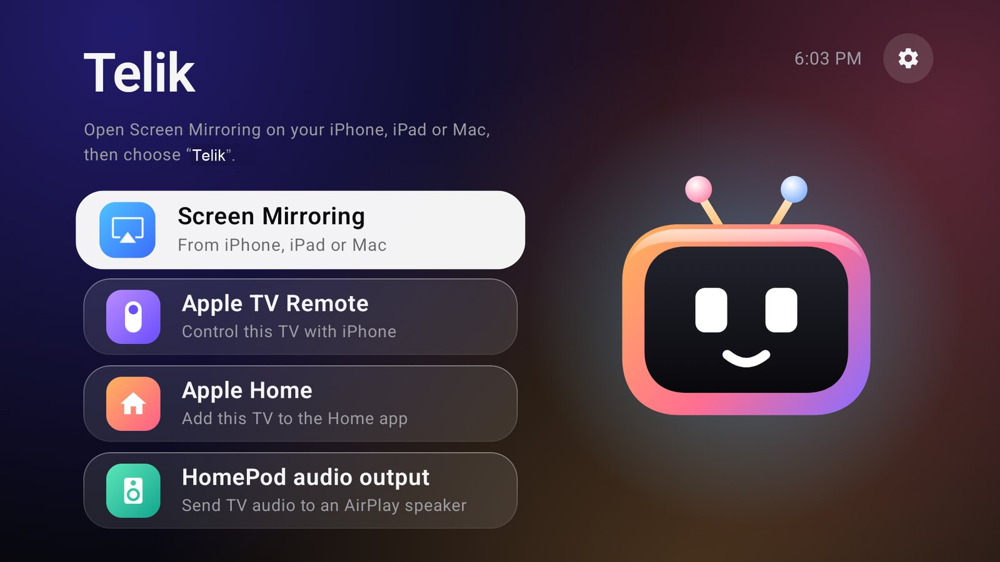

<p align="center"></p>

# Telik

Control Android TV with the built-in iPhone Apple TV Remote. Telik runs on the TV: no Apple TV box,
Homebridge, server or iPhone app.

[Website](https://andrewkomkov.github.io/telik/) · [Русский](README.ru.md) ·
[Download](https://github.com/andrewkomkov/telik/releases/latest)



## Features

- The Apple TV Remote in iPhone Control Center: touch area, click, back, TV button, play and pause.
- The iPhone keyboard for standard Android text fields, including Cyrillic. Apps that draw their own
  on-screen keyboard may not respond.
- AirPlay screen mirroring and audio from iPhone, iPad and Mac.
- A TV tile in Apple Home with power, volume and app inputs.
- Experimental TV audio output to a HomePod.
- No root and no local ADB connection after setup. Services start after the TV boots.

## Limits

- Protected video such as Apple TV+ and Netflix is not available over AirPlay. Telik does not
  decrypt DRM. Use those apps on the TV.
- AirPlay uses the UxPlay "legacy protocol". Apple may remove it in a future iOS release.
- Siri itself does not run on the TV. The side button starts Android voice search.
- Waking the TV from the iPhone needs a TV that keeps networking on in standby.
- An Android app cannot be made a system app without root, so it can be uninstalled.

Tested on a 32-bit Dahua 4K TV with Android 14 and an iPhone on iOS 27.2. Reports about other TVs
are welcome.

## Install

1. Install `telik-*-armv7.apk` from [Releases](https://github.com/andrewkomkov/telik/releases/latest)
   on an Android TV 13+ device.
2. Open Telik and allow accessibility access. It presses remote buttons and receives keyboard text.
3. On iPhone, open Control Center, tap the remote icon, choose Telik and enter the code from the TV.
4. For Apple Home, open **Home app** in Telik and scan the QR code.

Optional ADB commands for TVs that drop off the network in standby or refuse to wake:

```sh
adb shell pm grant dev.telik.tv android.permission.WRITE_SECURE_SETTINGS
adb shell appops set dev.telik.tv TURN_SCREEN_ON allow
adb shell dumpsys deviceidle whitelist +dev.telik.tv
```

To keep wireless debugging on after Wi-Fi drops and reboots, run the command below. Anyone on your network can then try to pair with the TV, so leave it off if you do not need it.

```sh
adb shell settings put global telik_keep_wireless_debugging 1
```

The first command allows Telik to turn off `low_power_standby_enabled`, which can use more power in
standby.

## Build

| Tool | Version |
| --- | --- |
| JDK | 21 |
| Rust | 1.98.0, target `armv7-linux-androideabi` |
| Android SDK platform | 37.0 |
| Android NDK | 27.0.12077973 |
| CMake | 3.22.1 |

```sh
git clone --recurse-submodules https://github.com/andrewkomkov/telik.git
cd telik
rustup target add armv7-linux-androideabi
scripts/build-remote.sh
./gradlew :app:testDebugUnitTest :app:assembleRelease
```

Build from a path without spaces: the native dependencies do not support them.

## Credits and license

GPL-3.0. Telik is a fork of
[Android TV AirPlay Hub](https://github.com/henry753951/android-tv-airplay-hub) and builds on
[atv-core](https://github.com/corvofeng/atv-core), [UxPlay](https://github.com/FDH2/UxPlay) and the
protocol research in [pyatv](https://github.com/postlund/pyatv). See
[THIRD_PARTY_NOTICES.md](THIRD_PARTY_NOTICES.md).

Telik is not affiliated with or endorsed by Apple or Google. Apple TV, AirPlay, HomePod, HomeKit,
iPhone and Siri are trademarks of Apple Inc. Android TV is a trademark of Google LLC.
