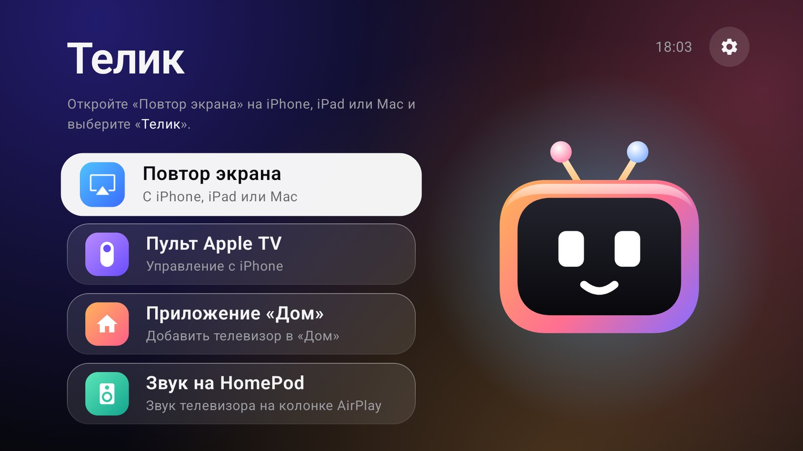

<p align="center"></p>

# Телик

Управление Android TV через встроенный пульт Apple TV на iPhone. Телик работает на самом телевизоре:
не нужны приставка Apple TV, Homebridge, сервер и приложения на iPhone.

[Сайт](https://andrewkomkov.github.io/telik/ru/) · [English](README.md) ·
[Скачать](https://github.com/andrewkomkov/telik/releases/latest)



## Возможности

- Пульт Apple TV в Пункте управления iPhone: сенсорная панель, нажатие, «назад», кнопка TV, пауза.
- Клавиатура iPhone для стандартных полей ввода Android, включая кириллицу. Приложения со своей
  экранной клавиатурой могут не реагировать.
- Повтор экрана и звук по AirPlay с iPhone, iPad и Mac.
- Плитка телевизора в приложении «Дом»: питание, громкость, приложения-входы.
- Экспериментальный вывод звука телевизора на HomePod.
- Без root и без локального ADB после настройки. Службы запускаются сами после загрузки телевизора.

## Ограничения

- Защищённое видео, например Apple TV+ и Netflix, по AirPlay недоступно: Телик не расшифровывает
  DRM. Открывайте эти приложения на телевизоре.
- AirPlay работает через режим UxPlay Legacy Protocol. Apple может убрать его в будущих версиях iOS.
- Сама Siri на телевизоре не работает. Боковая кнопка запускает голосовой поиск Android.
- Чтобы включать телевизор с iPhone, он должен оставаться в сети в режиме ожидания.
- Без root приложение нельзя сделать системным, поэтому его можно удалить.

Проверено на 32-битном телевизоре Dahua 4K с Android 14 и iPhone на iOS 27.2. Будем рады отчётам о
других моделях.

## Установка

1. Установите `telik-*-armv7.apk` со страницы
   [Releases](https://github.com/andrewkomkov/telik/releases/latest) на Android TV 13+.
2. Откройте Телик и разрешите доступ к специальным возможностям. Он нужен, чтобы нажимать кнопки
   пульта и получать текст с клавиатуры.
3. На iPhone откройте Пункт управления, нажмите значок пульта, выберите «Телик» и введите код с
   экрана телевизора.
4. Для «Дома» откройте в Телике пункт **Приложение «Дом»** и отсканируйте QR-код.

Необязательные команды ADB для телевизоров, которые пропадают из сети в режиме ожидания или не
просыпаются:

```sh
adb shell pm grant dev.telik.tv android.permission.WRITE_SECURE_SETTINGS
adb shell appops set dev.telik.tv TURN_SCREEN_ON allow
adb shell dumpsys deviceidle whitelist +dev.telik.tv
```

Первая команда разрешает Телику выключить `low_power_standby_enabled`. В режиме ожидания телевизор
может потреблять больше энергии.

Чтобы беспроводная отладка оставалась включённой после обрывов Wi-Fi и перезагрузок, выполните команду ниже. Тогда любой в вашей сети сможет попытаться сопрячься с телевизором, поэтому без необходимости её не включайте.

```sh
adb shell settings put global telik_keep_wireless_debugging 1
```

Инструкция по сборке, благодарности и лицензия: в [README на английском](README.md).

Телик не связан с Apple или Google и не одобрен ими. Apple TV, AirPlay, HomePod, HomeKit, iPhone и
Siri — товарные знаки Apple Inc. Android TV — товарный знак Google LLC.
